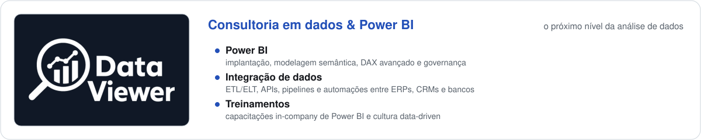
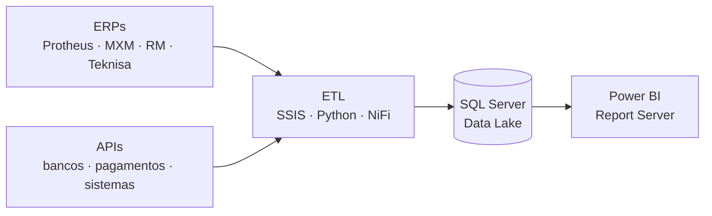

<picture>
  <source media="(prefers-color-scheme: dark)" srcset="assets/header-dark.svg">
  
</picture>

  
  
  
  

## Sobre mim

Engenheiro de Dados e Desenvolvedor BI no **SESC-MT** (Time de Dados · GTI) e responsável pela **[Dataviewer](https://dataviewer.com.br)**,
consultoria de BI, ETL e automação em Cuiabá-MT.

- 🔄 Construo pipelines de ponta a ponta: extração de ERPs e APIs, cargas em **SQL Server** com **SSIS** e **Python**, e bancos **Oracle, PostgreSQL e MariaDB**, orquestradas pelo **SQL Agent**.
- 📊 Transformo esses dados em painéis **Power BI** publicados no **Report Server**.
- 🔗 Integro sistemas de gestão: **TOTVS Protheus, MXM, RM e Teknisa**.
- 🛠️ Mais de 10 anos em TI: comecei em infraestrutura e hoje atuo em engenharia de dados e BI.
- 🎓 Sistemas de Informação · Pós-graduação em Ciência de Dados.

## Dataviewer — minha consultoria

Na **[Dataviewer](https://dataviewer.com.br)** levo para outras empresas o mesmo trabalho que faço no dia a dia:
projetos de Power BI, integração de dados entre sistemas e treinamentos.

<a href="https://dataviewer.com.br">
  <picture>
    <source media="(prefers-color-scheme: dark)" srcset="https://raw.githubusercontent.com/Dev-RodrigoCapel/Dev-RodrigoCapel/output/dataviewer-dark.svg">
    
  </picture>
</a>

<picture>
  <source media="(prefers-color-scheme: dark)" srcset="https://raw.githubusercontent.com/Dev-RodrigoCapel/Dev-RodrigoCapel/output/clientes-dark.svg">
  
</picture>

  
  
  

## Como os dados fluem nos meus projetos

## Stack

<table>
  <tr>
    <td><b>Banco de dados e ETL</b></td>
    <td>
      
      
      
      
      
      
      
      
      
    </td>
  </tr>
  <tr>
    <td><b>BI e Analytics</b></td>
    <td>
      
      
      
      
    </td>
  </tr>
  <tr>
    <td><b>Desenvolvimento e automação</b></td>
    <td>
      
      
      
      
      
    </td>
  </tr>
  <tr>
    <td><b>Integrações ERP</b></td>
    <td>
      
      
      
      
    </td>
  </tr>
</table>

## Estatísticas

  <picture>
    <source media="(prefers-color-scheme: dark)" srcset="https://raw.githubusercontent.com/Dev-RodrigoCapel/Dev-RodrigoCapel/output/stats-dark.svg">
    
  </picture>
  <picture>
    <source media="(prefers-color-scheme: dark)" srcset="https://raw.githubusercontent.com/Dev-RodrigoCapel/Dev-RodrigoCapel/output/langs-dark.svg">
    
  </picture>

<picture>
  <source media="(prefers-color-scheme: dark)" srcset="https://raw.githubusercontent.com/Dev-RodrigoCapel/Dev-RodrigoCapel/output/snake-dark.svg">
  
</picture>
